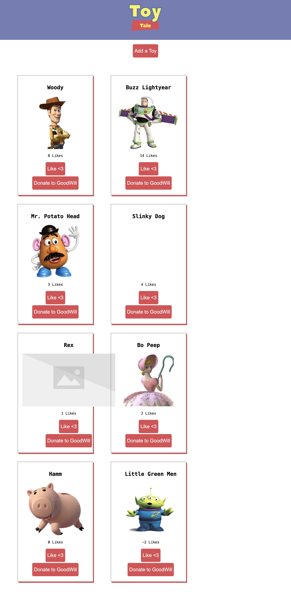

# Toy Tales

Toy Tales is a small React application for browsing and managing a collection of toys. Toy records are stored in `db.json` and served through a JSON Server REST API.

## Requirements

- Node.js and npm

## Run Locally

Install dependencies:

```sh
npm install
```

Start the backend in one terminal:

```sh
npm run server
```

The API is available at `http://localhost:3001/toys`.

Start the React application in another terminal:

```sh
npm run dev
```

Open the local URL printed by Vite (normally `http://localhost:5173`). Keep both processes running while using the app.

## Features

- Loads and displays toys from the backend when the page opens.
- Creates toys through the form, initializing each toy with zero likes.
- Increments likes and persists the new count to the backend.
- Donates a toy by deleting it from the backend and the page.
- Shows an error message when an API request fails.

## Tests

Run the test suite once:

```sh
npm run test -- --run
```

Run ESLint and create a production build:

```sh
npm run lint
npm run build
```

## Screenshot


